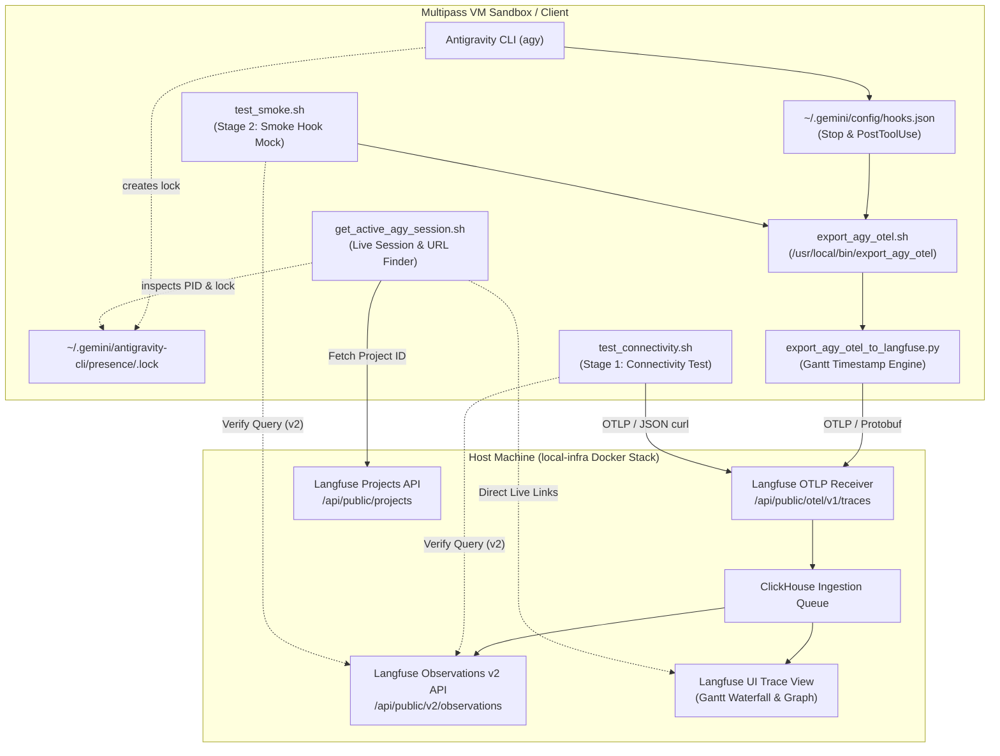

# OpenTelemetry & Langfuse Tracing Guide for Antigravity (AGY)

This document provides a comprehensive operational summary of the OpenTelemetry (OTel) instrumentation, tracing architecture, and multi-stage verification suite for Antigravity (AGY) in `local-infra`.

---

## Architecture & Data Flow



---

## 1. `test_connectivity.sh` — Stage 1: Pure OTLP HTTP Ingestion via `curl`

* **Path**: [`scripts/test_connectivity.sh`](../scripts/test_connectivity.sh)
* **Role**: **Stage 1 Connectivity & Pre-flight Test**
* **Purpose**: Directly tests network connectivity and compatibility with Langfuse's OpenTelemetry HTTP receiver (`/api/public/otel/v1/traces`) using a pure `curl` command. Bypasses Python and Antigravity hooks entirely for instant, zero-dependency validation.

### Key Features
* Generates a 16-byte random trace ID (32 hex characters) and an 8-byte span ID (16 hex characters).
* Crafts an OTLP v1 JSON span payload:
  * Resource attribute: `service.name = "sandbox-curl-test"`
  * Scope: `test-connectivity-curl-scope`
  * Span: `manual_otlp_curl_span`
* Sends HTTP POST to `${LANGFUSE_URL}/api/public/otel/v1/traces` with header `x-langfuse-ingestion-version: 4`.
* Queries `/api/public/v2/observations?traceId=<TRACE_ID>` to verify that the span was recorded in ClickHouse.

### Usage
```bash
bash scripts/test_connectivity.sh
```

---

## 2. `test_smoke.sh` — Stage 2: Stop Hook Payload Simulation

* **Path**: [`scripts/test_smoke.sh`](../scripts/test_smoke.sh)
* **Role**: **Stage 2 Smoke & Pipeline Integration Test**
* **Purpose**: Tests the Antigravity OpenTelemetry exporter pipeline without executing a full LLM turn, isolating and validating the shell wrapper, Python venv runtime, and OTel Protobuf serialization.

### Key Features
* Generates a random test UUID for `conversationId` and maps it to `CLEAN_TRACE_ID`.
* Pipes a synthetic Antigravity `Stop` hook JSON payload into `export_agy_otel`:
  ```json
  {"terminationReason":"completed","conversationId":"<UUID>","modelName":"dummy-test-agent"}
  ```
* Waits 1 second for Langfuse ingestion and ClickHouse queue processing.
* Queries `/api/public/v2/observations?traceId=<CLEAN_TRACE_ID>` using HTTP Basic Auth to assert success.

### Usage
```bash
bash scripts/test_smoke.sh
```

---

## 3. `export_agy_otel.sh` — Exporter Shell Wrapper & Environment Validator

* **Path**: [`scripts/export_agy_otel.sh`](../scripts/export_agy_otel.sh)
* **Symlink Target**: `/usr/local/bin/export_agy_otel`
* **Purpose**: Thin wrapper invoked directly by Antigravity hooks (`PostToolUse` and `Stop`). Resolves environment variables, ensures strict validation (no silent fallbacks), locates an OTel-capable Python runtime, and forwards stdin payloads to `export_agy_otel_to_langfuse.py`.

### Built-in Options
| Option | Description |
| :--- | :--- |
| `export_agy_otel` | Default execution: validates `.env`, picks Python venv, runs exporter. |
| `export_agy_otel --check` | Queries remote GitHub repository and compares ETag version. |
| `export_agy_otel --update` | Downloads the latest exporter scripts from GitHub (SSOT). |
| `export_agy_otel --version` | Prints currently installed version / ETag. |

### Strict Environment Validation
Following the zero-fallback principle, `export_agy_otel.sh` verifies:
* `IS_LANGFUSE_ENABLED`: Must be `"true"`. If `"false"`, exits cleanly with `{}`.
* `LANGFUSE_UI_PORT`: Must be set (e.g., `3100`).
* `LANGFUSE_CONNECT_IP`: Host IP / Gateway (e.g., `127.0.0.1` or `10.120.213.1`).
* `LANGFUSE_SERVER_URL`: Full base URL (e.g., `http://${LANGFUSE_CONNECT_IP}:${LANGFUSE_UI_PORT}`).
* `LANGFUSE_PUBLIC_KEY` & `LANGFUSE_SECRET_KEY`: Basic auth credentials.

### Runtime Resolution Order
1. `AGY_HOOKS_PYTHON` environment override.
2. Centralized venv: `~/.gemini/antigravity-cli/hooks_env/.venv/bin/python3`.
3. Project local venv: `${PWD}/.venv/bin/python3`.
4. System Python: `/usr/bin/python3` (if `opentelemetry` modules are installed).

---

## 4. `export_agy_otel_to_langfuse.py` — Core OpenTelemetry Exporter Engine

* **Path**: [`scripts/export_agy_otel_to_langfuse.py`](../scripts/export_agy_otel_to_langfuse.py)
* **Purpose**: Core Python script responsible for reading transcript events, computing chronological timestamps, building OTel span trees, and shipping traces to Langfuse.

### Gantt Chart Timeline Construction Logic
1. **Root Span (`agent:turn`)**:
   * Covers total duration from user prompt submission (`turn_start_ns`) until turn completion (`turn_end_ns`).
   * Attributes: `input.value`, `output.value`, `session.id`, `sessionId`.
2. **Prompt Span (`prompt:user_input`)**:
   * Explicit span representing prompt ingestion phase (`0.15s - 0.5s`).
3. **Planner Generations (`planner:step_X`)**:
   * Type: `GENERATION`.
   * Captures model thinking, token usage (`prompt_tokens`, `completion_tokens`, `total_tokens`), and planning decisions.
4. **Tool Execution Spans (`tool:<tool_name>`)**:
   * Type: `SPAN`.
   * Nested directly under the calling planner step.
   * Includes tool input arguments (`input.value`) and outputs (`output.value`).
5. **Final Synthesis (`agent:response`)**:
   * Type: `GENERATION`.
   * Spans from the conclusion of the last tool execution to the turn end.
6. **Session Correlation**:
   * Sets `session.id`, `sessionId`, and `langfuse.session.id` on **all spans**, enabling trace tree filtering in Langfuse.

---

## 5. `get_active_agy_session.sh` — Active Session Discovery & Live Langfuse URL Resolver

* **Path**: [`scripts/get_active_agy_session.sh`](../scripts/get_active_agy_session.sh)
* **Purpose**: Discovers active Antigravity CLI session metadata (`Project ID`, `Session ID`, `Trace ID`) in real time and generates direct, clickable Langfuse UI URLs without parsing chat history.

### Key Features
* **Zero History Overhead**: Does not scan or parse past transcript logs.
* **Dynamic Project ID Discovery**: Queries Langfuse REST API (`GET /api/public/projects`) using API keys from `.env`.
* **Real-time Session ID Detection**: Detects the running `agy` process lock (`pgrep -n agy` -> `lsof -p <PID>` -> `<UUID>.lock`), with fallback to `~/.gemini/antigravity-cli/presence/`.
* **Trace ID Derivation**: Converts session UUID into canonical unhyphenated 128-bit hex trace ID (`runId`).
* **Direct UI Links**: Outputs immediate links for:
  * **Live Trace View (Graph / Gantt Mode)**: `${LANGFUSE_URL}/project/${PROJECT_ID}/traces/${CLEAN_TRACE_ID}?traceId=${CLEAN_TRACE_ID}&view=graph`
  * **Live Session View (All turns)**: `${LANGFUSE_URL}/project/${PROJECT_ID}/sessions/${SESSION_ID}`

### Usage
```bash
bash scripts/get_active_agy_session.sh
```

---

## Testing Matrix & Strategy

| Aspect | `test_connectivity.sh` | `test_smoke.sh` |
| :--- | :--- | :--- |
| **Role & Stage** | **Stage 1: Connectivity / Pre-flight** | **Stage 2: Smoke / Pipeline Integration** |
| **Mechanism** | Raw OTLP JSON via `curl` | Synthetic Stop hook JSON pipe |
| **Target Scope** | Network reachability & OTLP endpoint | Shell wrapper & Python OTel exporter |
| **LLM Call / Cost** | None ($0) | None ($0) |
| **Dependencies** | `curl`, `openssl` (0 Python/AGY) | Python venv, OTel packages |
| **Duration** | < 0.5s | ~ 1–2s |
| **Pass Criteria** | HTTP 200 & trace in observations API | Trace verified in observations API |
